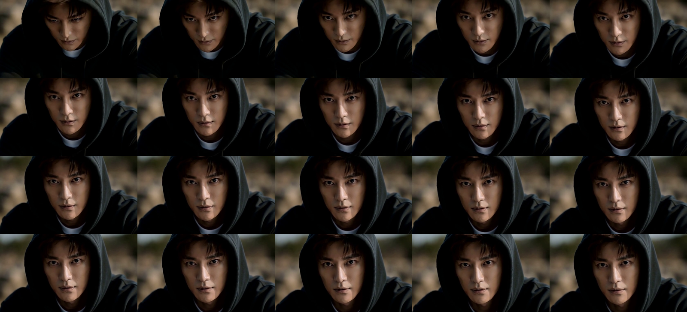
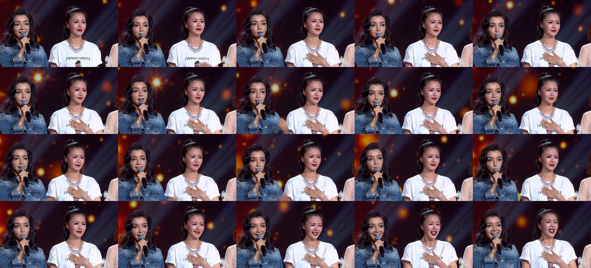
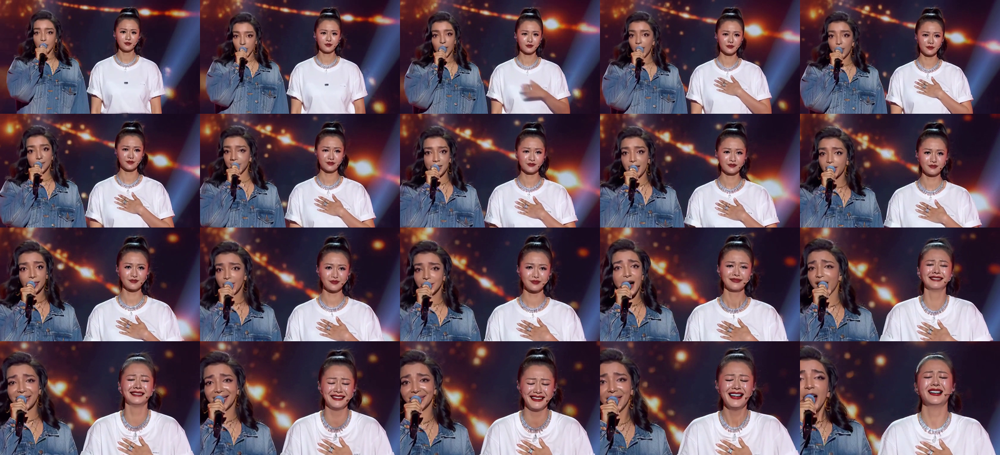

# ComfyUI-Qwen3.5-H3

Use **Qwen/Qwen3.5-9B** as a multimodal (`<Picture 1..N>` + text) conditioning encoder for **MiniMax-H3 Ref2VA** in ComfyUI.

This node extracts intermediate layer representations (tap 20, unnormalized) from `Qwen/Qwen3.5-9B`, formats prompts and static image references using MiniMax-H3's exact layout (`<Picture i>: <vision block> ... <prompt>`, no chat template), applies a trained `4096 -> 5120` projection (and optional LoRA), and emits standard ComfyUI `CONDITIONING` with `minimax_token_tags`.

All downstream MiniMax-H3 nodes (`MiniMaxH3ReferenceToVideo`, `MiniMaxH3SigmaShift`, `KSampler`, `VAEDecode`) work out of the box.

## Installation

```bash
cd ComfyUI/custom_nodes
git clone https://github.com/alisson-anjos/ComfyUI-Qwen3.5-H3.git
cd ComfyUI-Qwen3.5-H3
pip install -r requirements.txt
```

Restart ComfyUI.

## Node Usage

1. Load your Qwen3.5-9B text encoder (`qwen3.5_9b_bf16.safetensors`, `qwen3.5_9b_int8_convrot.safetensors`, or `qwen3.5_9b_w4a8_gptq.safetensors` from [Comfy-Org/Qwen3.5](https://huggingface.co/Comfy-Org/Qwen3.5/tree/main/text_encoders)) using ComfyUI's native **`Load CLIP`** (`CLIPLoader`).
2. Connect its `CLIP` output to **`Apply Qwen3.5-H3 Projection & LoRA`** (`Qwen35H3Apply`, under `conditioning/minimax`):
   - **`use_lora`**: `True` *(enables the trained rank-16 LoRA on `visual.merger` + layers 12–19)*
   - **`auto_download`**: `True` *(automatically downloads `minimax_h3_qwen3.5_9b_projection.safetensors` and `minimax_h3_qwen3.5_9b_lora.safetensors` from [Alissonerdx/Qwen3.5-9B-Minimax-H3](https://huggingface.co/Alissonerdx/Qwen3.5-9B-Minimax-H3))*
3. Connect the `CLIP` output directly to ComfyUI's official **`MiniMax H3 Reference to Video`** (`MiniMaxH3ReferenceToVideo`) node.

## What is `minimax_h3_qwen3.5_9b_lora.safetensors`?

It is a **rank-16 LoRA (34 linear modules)** trained **jointly** with `minimax_h3_qwen3.5_9b_projection.safetensors` against MiniMax-H3's `Qwen3-VL-32B` teacher:
- **`model.visual.merger` (`linear_fc1`, `linear_fc2`)**: adapts how `<Picture 1..N>` reference image patches are projected into the language stream, significantly improving reference/identity fidelity (`vision` cosine `0.7873 -> 0.8867`).
- **Language layers `12–19` (`o_proj`, `gate_proj`, `up_proj`, `down_proj`, `out_proj`)**: aligns the hidden states right before the layer-20 tap (`text` cosine `0.8919 -> 0.9492`).

At load time, `Qwen35H3ClipLoader` merges the LoRA directly into the linear weights (`W += (alpha / r) * B @ A`), adding **zero runtime overhead**.

## Baseline Results (Projection Only — Without LoRA)

The initial baseline (`minimax_h3_qwen3.5_9b_projection.safetensors` without LoRA) was evaluated on **20 held-out multi-reference cases** (`1` to `4` reference images per case) from `WithAnyone/MultiID-Bench`, comparing **Native MiniMax-H3 (Qwen3-VL-32B INT8)** vs **Qwen3.5-9B + Projection** with identical seeds, steps, resolution (`672x384`, `124` frames, `24` fps), and reference images:

- **Validation Cosine Similarity (118 held-out sources)**: `0.8396` overall (`text: 0.8919`, `vision: 0.7873`)
- **20-Case Paired Video Comparison** (`evidence/video_comparison.json`):
  - Mean PSNR: `12.877 dB`
  - Mean Frame Correlation: `0.441`
  - Mean Generation Time (4-step Pika Ref2VA + Turbo): `15.77s` (native) vs `20.68s` (Qwen3.5-9B projected)

> **Note:** Joint **LoRA (`visual.merger` + layers 12–19) + Projection** training is currently in progress to boost `<Picture 1..N>` reference fidelity (Epoch 2 validation already reached **`0.9492` text** / **`0.8867` vision** / **`0.9180` overall**). LoRA comparison examples will be added next!

### Visual Examples (Projection Only, No LoRA)

Each comparison video includes the ordered `<Picture 1..N>` references at the top, **Native H3 (32B INT8)** on the left, **Qwen3.5-9B + Projection** on the right, and the H3 prompt at the bottom:

#### Case 01 (1 reference — PSNR `14.165 dB`, Frame Corr `0.4378`)
- [Side-by-side comparison video (`case_01_comparison.mp4`)](showcase/videos/case_01_comparison.mp4)

| Native H3 (32B INT8) | Qwen3.5-9B + Projection (No LoRA) |
|---|---|
|  |  |

#### Case 02 (2 references — PSNR `12.538 dB`, Frame Corr `0.6657`)
- [Side-by-side comparison video (`case_02_comparison.mp4`)](showcase/videos/case_02_comparison.mp4)

| Native H3 (32B INT8) | Qwen3.5-9B + Projection (No LoRA) |
|---|---|
|  |  |

#### Case 03 (3 references — PSNR `15.498 dB`, Frame Corr `0.5220`)
- [Side-by-side comparison video (`case_03_comparison.mp4`)](showcase/videos/case_03_comparison.mp4)

| Native H3 (32B INT8) | Qwen3.5-9B + Projection (No LoRA) |
|---|---|
|  |  |

## Evidence Files

- [`evidence/validation_metrics.json`](evidence/validation_metrics.json)
- [`evidence/video_comparison.json`](evidence/video_comparison.json)
